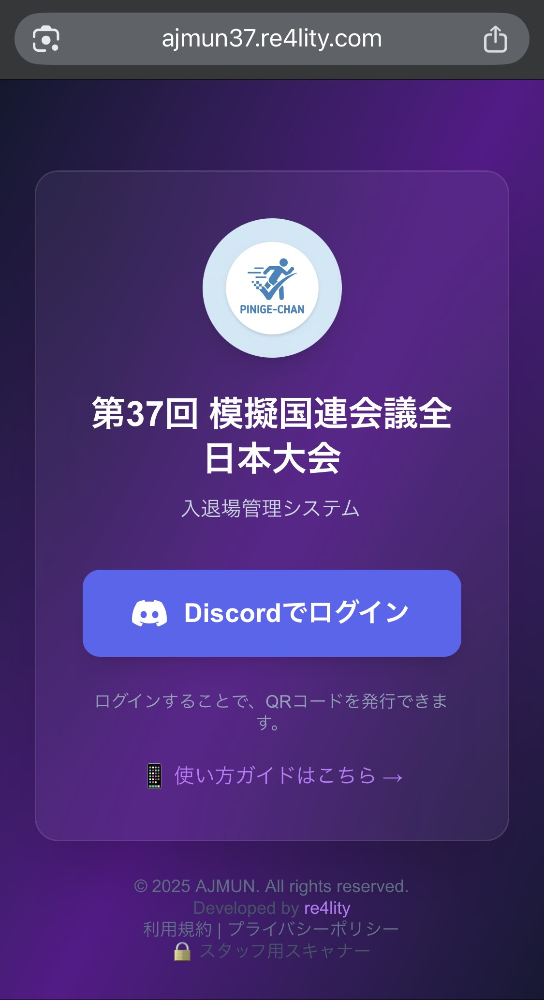

# AJMUN Event Management System

Event entry management system for Model United Nations conferences with Discord OAuth authentication and QR code scanning.

## Features

<table>
<tr>
<td width="65%">

- **Discord OAuth Authentication**: Users log in with Discord to receive their QR code
- **QR Code Distribution**: Mass distribution via Bot DM or Web login
- **Reception Scanner**: Cloudflare Access protected staff-only scanning page
- **Attendance Management Bot**: Check and manage attendance via Slash commands
- **Multi-Server Support**: Multiple conference servers + operations server
- **Google Sheets Sync**: Automatic attendance data synchronization

</td>
<td width="35%">



</td>
</tr>
</table>

## Bot Commands

| Command | Description | Permission |
|---------|-------------|------------|
| `/attendance status` | Attendance summary | Organizer+ |
| `/attendance present` | List checked-in users | Organizer+ |
| `/attendance absent` | List absent users | Organizer+ |
| `/attendance checkin` | Manual check-in | Organizer+ |
| `/system sync` | Sync member data | Staff+ |
| `/system show` | Show system config | Admin |
| `/system send-qr` | Send QR codes via DM | Admin |
| `/system dm-status` | DM send status | Admin |
| `/setup *` | Initial server setup | Admin |
| `/help` | Show help | Anyone |

**Filter Options** (for `/attendance status/present/absent`):
- `conference`: Filter by conference server (autocomplete)
- `attribute`: Filter by role (participant/organizer/staff)
- `date`: Filter by date (YYYY-MM-DD, defaults to today)

## Tech Stack

- **Frontend**: Next.js 16, React
- **Backend**: Next.js API Routes
- **Database**: SQLite (Prisma ORM)
- **Authentication**: Discord OAuth2 + JWT Sessions
- **Bot**: Discord.js
- **Hosting**: OCI + Cloudflare

## Quick Start

```bash
git clone https://github.com/sudolifeagain/ajmun-x.git
cd ajmun-x
npm install
npx prisma db push

# Start development servers
npm run dev      # Web app
npm run bot      # Discord Bot (separate terminal)
```

Use Node.js 24 LTS (the CI and Docker runtime use the same major version).

Before merging changes, run `npm run audit`, `npm test`, `npm run lint`,
`npm run typecheck`, and `npm run build`. The type check includes the Discord bot.
CI also scans Git history for secrets and builds/audits the production Docker image.
Production deployment is a reusable workflow called only after successful main-push CI.
The production entrypoint validates configuration before starting: configure a
random `SESSION_SECRET` of at least 32 characters, distinct from `QR_SECRET`,
and HTTPS base/callback URLs. Invalid configuration or failed database setup aborts startup.

The full dependency audit temporarily permits only the unpatched, development-only
`braces@3.0.3` advisory GHSA-vfj7-8cjw-p6xm, with a review deadline of 2026-11-14.
Production dependencies and all other advisories must pass the audit gate.

## Environment Variables

```env
DISCORD_CLIENT_ID=your_client_id
DISCORD_CLIENT_SECRET=your_client_secret
DISCORD_REDIRECT_URI=http://localhost:3000/api/auth/discord/callback
DISCORD_BOT_TOKEN=your_bot_token
DATABASE_URL=file:./prisma/dev.db
QR_SECRET=your-random-secret-32chars-or-more
NEXT_PUBLIC_BASE_URL=http://localhost:3000
EXPORT_API_KEY=your-api-key-for-sheets-sync
```

## Documentation

For detailed setup and deployment instructions, see [docs/GUIDE.md](docs/GUIDE.md).

## Directory Structure

```
ajmun-x/
├── app/                    # Next.js App Router
│   ├── api/                # API Routes
│   │   ├── auth/           # Discord OAuth
│   │   ├── scan/           # QR Scan
│   │   └── attendance-export/  # Sheets sync
│   ├── staff/              # Reception scanner
│   ├── ticket/             # QR code display
│   └── lib/                # App utilities
├── bot/                    # Discord Bot
│   ├── commands/           # Slash commands
│   ├── events/             # Event handlers
│   ├── services/           # Business logic
│   └── utils/              # Bot utilities
├── lib/
│   └── shared/             # Shared utilities (logger, date, guildResolver)
├── prisma/                 # Prisma schema
└── docs/                   # Documentation
```

## License

Private - All rights reserved.
